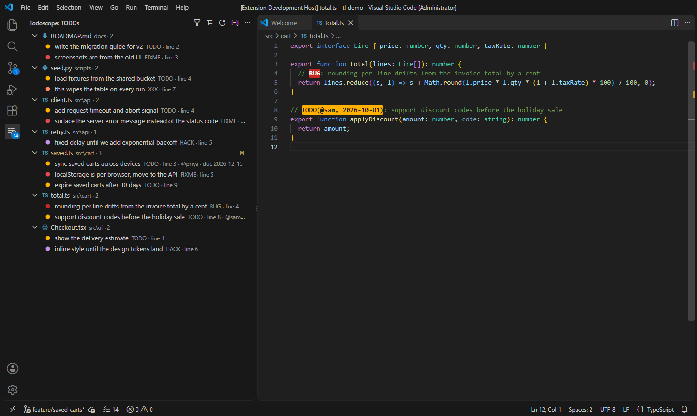
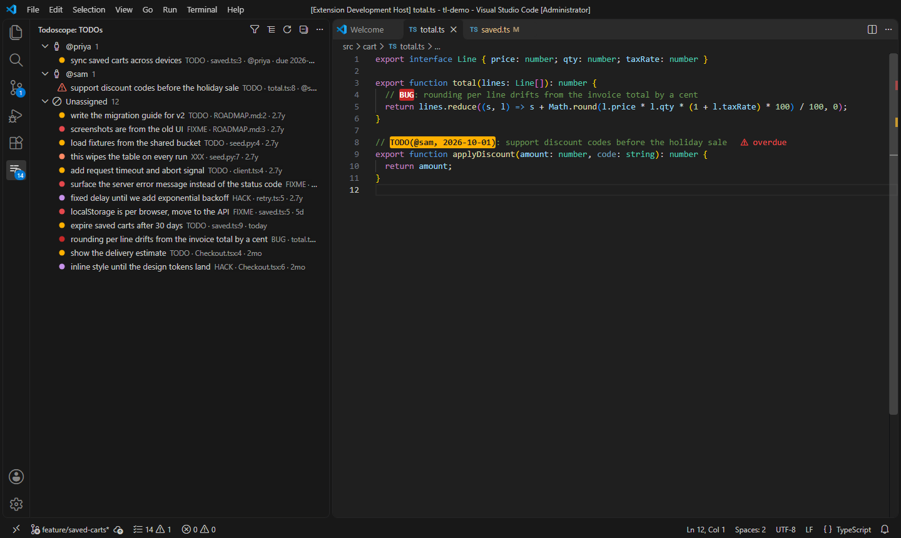

# Todoscope

**Every TODO, FIXME, BUG and HACK in your workspace, in one fast tree, with highlights in the editor.**

**Free.** Pro is **$12 a year or $29 once**, with a **7-day Pro trial, no card needed**. Licences are per person: one key covers all of your own machines and editors.

Todoscope has its own scanner built in. There is no ripgrep binary to find, so nothing breaks when VS Code updates, and it works the same in VS Code, Cursor, Windsurf and VSCodium, locally or over Remote SSH, WSL, Dev Containers and Codespaces.

## Switching from another TODO extension

Run **Todoscope: Import Todo Tree Settings** (it is also offered on first start). It tells you exactly what it copied.

**Carries over:** your tags, colours, include and exclude globs, case setting and custom regex. A custom regex that uses `$TAGS` works unchanged.

**Does not carry over:** keybindings and named scopes. Set those up again if you used them.

Then disable Todo Tree, so you don't see every TODO twice.

What you gain: no ripgrep to install or break after a VS Code update, and the TODOs you added on your current branch (Pro).

## Free features

- **Workspace tree** of every tagged comment, grouped by file, folder tree or tag. Click to jump to the line.
- **Editor highlights** for each tag in its own colour, plus marks in the scroll bar. Highlight just the tag or the whole line.
- **Live updates**: the tree changes as you type, save, create or delete files, and switch branches.
- **Comment-aware matching** for 40+ languages: `//`, `#`, `/* */`, `<!-- -->`, `--`, `;`, `%`, `'`, `REM`, docstrings, JSDoc, JSX and Markdown lists. `const status = 'TODO'` and `TODOS` are not counted.
- **Respects .gitignore** (nested files and `!` rules) and skips `node_modules`, build output, lock files, minified files and binaries automatically.
- **Filters**: by text, by tag, with one-click clear. The status bar shows the count.
- **Next / previous TODO**: `Alt+Shift+]` and `Alt+Shift+[` across the whole workspace.
- **Your own tags and colours**, case-sensitive or not, or your own regex.
- **Fast on big repos**: the VS Code source tree (21,000 files) scans in about 1.5 seconds. After that, only changed files are rescanned.

## Pro features

- **TODOs added on this branch**: show only the TODOs you added on this branch compared with `main` (or any branch, tag or commit), including work you haven't committed yet. Good for reviewing your own PR before you push.
- **Who and when**: author and age of every TODO from `git blame`, in the tree and tooltip.
- **Stale TODOs**: list the ones older than N days (180 by default).
- **Due dates, assignees and priority**: write `TODO(@sam, 2027-01-15): migrate` and Todoscope marks it overdue when the date passes, and can group the tree by assignee. `@due(2027-01-15)`, `!high` and `(p1)` also work.
- **Reports**: export what the tree shows to Markdown (a checklist for a PR, standup or tech-debt review), CSV or JSON.

**Try every Pro feature free for 7 days**, no key or card needed: run any Pro command and choose *Start 7-Day Free Trial*.

| | Price |
|---|---|
| Pro Yearly | **$12 / year** |
| Pro Lifetime | **$29 once** |

One license key works on all of your machines and editors. Buy with **Todoscope: Get Todoscope Pro**, then run **Todoscope: Enter Pro License Key**. The key is checked once a week and keeps working offline for up to three weeks.

## Commands

| Command | |
|---|---|
| Todoscope: Show TODO List | Open the tree |
| Todoscope: Go to Next / Previous TODO | `Alt+Shift+]` / `Alt+Shift+[` |
| Todoscope: Filter by Text / Filter by Tag / Clear Filters | Narrow the tree |
| Todoscope: Group By… | File, folder tree, tag, assignee (Pro) |
| Todoscope: Rescan Workspace | Full rescan |
| Todoscope: Import Todo Tree Settings | Move your setup over |
| Todoscope: Show TODOs Added Since Branch… | Pro |
| Todoscope: Toggle Stale TODOs Only | Pro |
| Todoscope: Toggle Overdue TODOs Only | Pro |
| Todoscope: Export TODO Report… | Pro |

## Settings

| Setting | Default | |
|---|---|---|
| `todoLens.tags` | `TODO FIXME BUG HACK XXX` | Tags to find |
| `todoLens.caseSensitive` | `true` | `TODO` but not `todo` |
| `todoLens.highlights` | built-in colours | `{"TODO": {"foreground": "#000", "background": "#FFB000"}}` |
| `todoLens.highlightStyle` | `tag` | `tag`, `line` or `none` |
| `todoLens.exclude` | `[]` | Extra paths to skip (`dist/`, `**/generated/**`) |
| `todoLens.include` | `[]` | Only scan these (`src/`, `*.py`) |
| `todoLens.useGitignore` | `true` | Skip files in .gitignore |
| `todoLens.maxFileSizeKB` | `1024` | Skip larger files |
| `todoLens.scope` | `workspace` | `workspace`, `openFiles` or `currentFile` |
| `todoLens.gutterIcons` | `false` | Coloured dot in the gutter on each TODO line |
| `todoLens.groupBy` | `file` | `file`, `folder`, `tag`, `assignee` |
| `todoLens.customRegex` | empty | Your own regex with `$TAGS` |
| `todoLens.staleDays` | `180` | Pro: age that counts as stale |

## Privacy

Todoscope reads your files locally and sends nothing anywhere. The only network call is the weekly license check for Pro users, which sends the license key to Polar (the store that sells it) and nothing else. Git features run your local `git` and are turned off in untrusted workspaces.

## Support

Questions, bugs and ideas: [open an issue](https://github.com/Myzles/todo-lens/issues). Billing and keys: the link in your Polar receipt.
